<p align="center">
  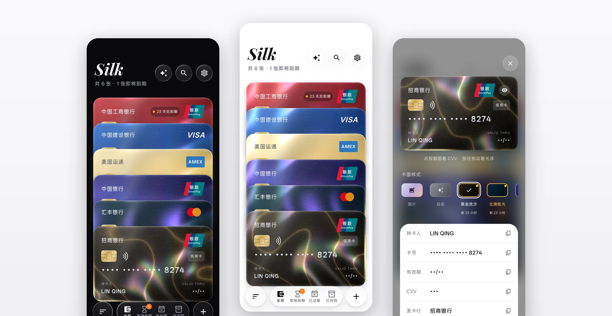
</p>

<h1 align="center">Silk</h1>

<p align="center">
  <b>一个只存在你手机里的银行卡包</b><br>
  纯白底 · 液态玻璃 · 会随手机倾斜流动的丝绸卡面
</p>

<p align="center">
  <a href="https://github.com/accomplish07zrh-eng/silk-wallet/releases/latest"></a>
  
  
  <a href="LICENSE"></a>
</p>

Silk 把银行卡号、有效期、CVV 收进一个加密的本地卡包：不注册、不联网、不上传。打开它，像把一叠实体卡摊在桌上。每张卡都有自己的光泽，倾斜手机时光会在卡面上流动。

> 截图里的卡号、姓名都是虚构的演示数据。

## 下载

到 [Releases](https://github.com/accomplish07zrh-eng/silk-wallet/releases/latest) 下载最新的 `Silk-x.y.z.apk` 直接安装。以后在应用里「设置 → 检查更新」就能一键升级。

## 卡面会动

<table>
  <tr>
    <td align="center" width="33%">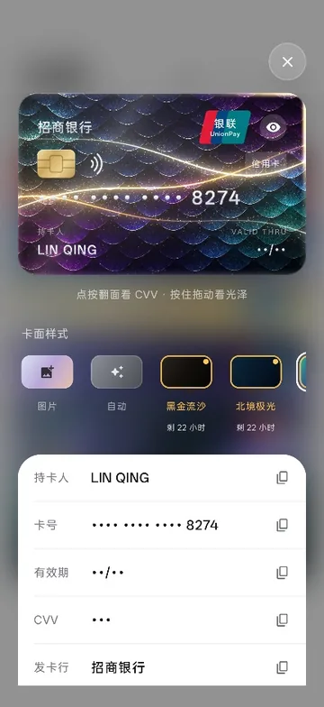</td>
    <td align="center" width="33%"></td>
    <td align="center" width="33%"></td>
  </tr>
  <tr>
    <td align="center"><b>光会流动</b><br><sub>卡面由着色器实时渲染，倾斜或拖动卡片时，光泽、虹彩和覆膜反光跟着变化</sub></td>
    <td align="center"><b>拿起一张卡</b><br><sub>点卡片，它从堆叠里飞出、放大到眼前；关闭时原路飞回</sub></td>
    <td align="center"><b>液态底栏</b><br><sub>底栏在分类之间像液体一样流过去，整条玻璃会轻微晃动</sub></td>
  </tr>
</table>

页头和底栏也会动：上滑时大标题收成紧凑标题，在顶部继续下拉，整叠卡片像橡皮筋一样被拉下来，「Silk」字标随之放大并扫过一道金光；底栏选中的图标由线框变成实心黑，按住底栏左右拖，经过的图标会放大，松手即切换。

细节上也下了功夫：深色卡面的卡号是银箔凸印字；按钮和底栏的玻璃边会随倾斜闪出高光；复制后图标变成对勾；数字变化时上下翻动；点卡、翻面、复制都有轻微震动。冷启动时还有一段「Silk」字标动画。

## 一叠卡，一眼看清

<table>
  <tr>
    <td align="center" width="33%">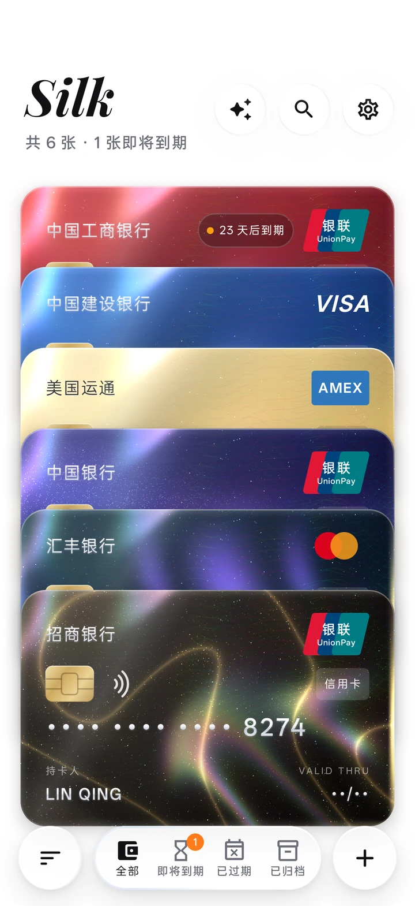</td>
    <td align="center" width="33%">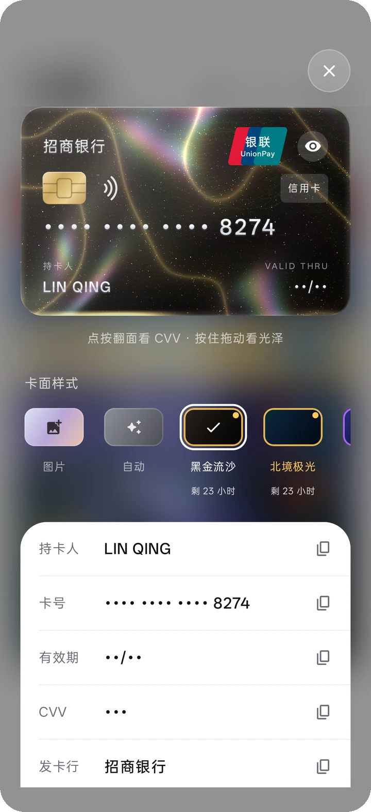</td>
    <td align="center" width="33%">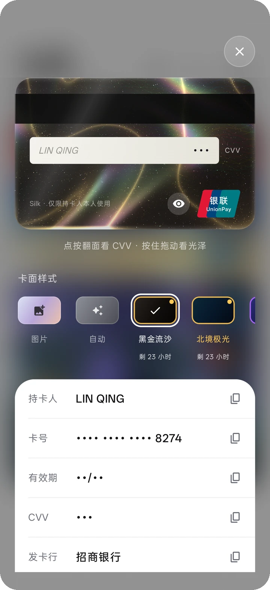</td>
  </tr>
  <tr>
    <td align="center"><b>卡片堆叠</b><br><sub>长按拖动排序，左滑归档或删除（可撤销），快到期的卡会标出来</sub></td>
    <td align="center"><b>详情</b><br><sub>背景磨砂虚化；每一项点一下就复制，剪贴板到时自动清空</sub></td>
    <td align="center"><b>翻面</b><br><sub>点卡面翻到背面看 CVV；默认打码，点眼睛才显示</sub></td>
  </tr>
</table>

<table>
  <tr>
    <td align="center" width="50%">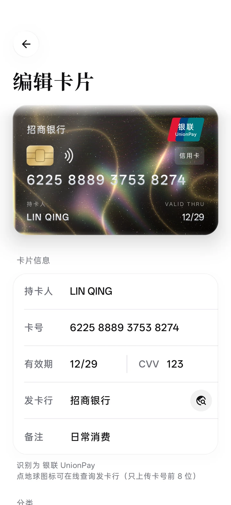</td>
    <td align="center" width="50%">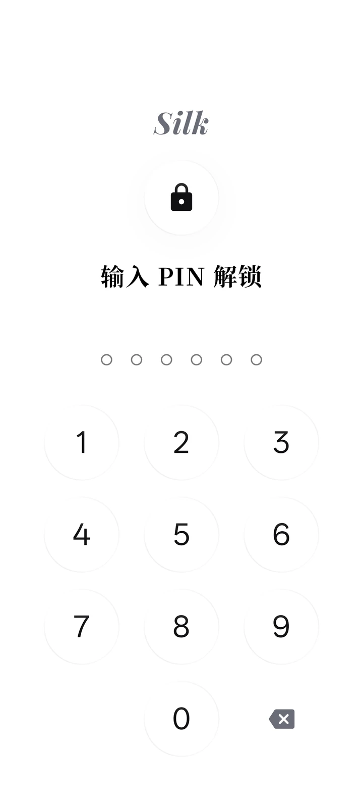</td>
  </tr>
  <tr>
    <td align="center"><b>添加卡片</b><br><sub>边输入边预览；自动识别银联、Visa、Mastercard、AmEx、JCB 和常见发卡行；也能用 NFC 贴卡读取</sub></td>
    <td align="center"><b>上锁</b><br><sub>6 位 PIN 与指纹 / 面容解锁，离开一段时间或息屏后自动锁上</sub></td>
  </tr>
</table>

## 平铺陈列

不想叠着看，可以在底栏左边的菜单里切到平铺：两列、三列、四列都行，平铺时双指捏合也能直接改列数。点卡片同样飞出到详情，长按弹出编辑 / 归档 / 删除。

<table>
  <tr>
    <td align="center" width="50%">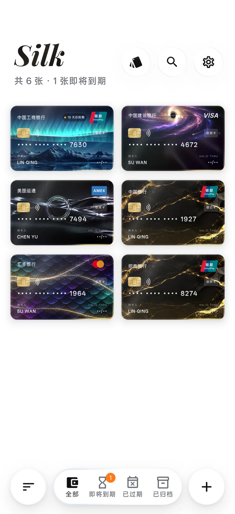</td>
    <td align="center" width="50%">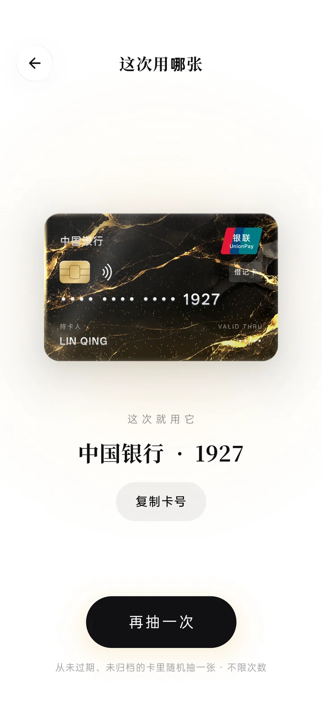</td>
  </tr>
  <tr>
    <td align="center"><b>平铺</b><br><sub>每张卡完整摊开，一眼看全</sub></td>
    <td align="center"><b>这次用哪张</b><br><sub>点首页右上角的卡片图标，3D 轮盘转一圈帮你决定；不限次数，一天刷几次卡就抽几次</sub></td>
  </tr>
</table>

## 皮肤

所有皮肤都可以直接选用。在卡片详情或编辑页的「卡面样式」里点一下就能预览。带底图的皮肤会显示卡面缩略图。

### 动态卡面

倾斜手机或在详情页拖动卡片，光线、反射和粒子会跟着变化。

#### 硅基神话

在「卡面样式」中可选这十张插画卡面。使用提供的插画与 [AI 娘设定图集](https://github.com/lmy414/ai-chan-sheets) 的角色主题，原角色设计归 ZipZipPipe（胖次狐）。

| 卡面 | 动效 |
| --- | --- |
| DeepSeek · 深海鲸歌 | 座头鲸游过，发梢随水摆动，唇边食指轻晃。倾斜时改变鲸与发梢的视差。 |
| Claude | 暖光在彩窗与菊花饰纹间流转，花瓣翻卷。倾斜时偏移光束与花瓣。 |
| GPT | 龙鳞逐段泛出青光，玉珠外有光点环绕。倾斜时改变鳞面光泽和光环角度。 |
| Gemini | 两颗四角星交替脉动，星光沿连线传递。倾斜时星线拐点产生视差。 |
| Grok | 蝠群掠过血月，酒液与杯中高光轻晃。倾斜时杯中光线随酒面偏转。 |
| 智谱 GLM | 耳尖轻动，沙金沿沙丘流过。倾斜时改变风沙的方向与范围。 |
| 文心一言 | 飞鸟穿过青墨远山，雾层以不同速度移动。倾斜时远山与近雾产生视差。 |
| 通义千问 | 天灯在云海中摇晃升起，暖光明灭。倾斜时远近天灯偏移不同距离。 |
| Kimi | 流星越过月牙，银发和坠饰轻摆。倾斜时改变月面阴影与坠饰角度。 |
| MiniMax | 海沫往复拍岸，螺纹水波与泡沫逐层散开。倾斜时水波的位置和透视改变。 |

#### 其他卡面

- **霓虹** · 霓虹灯随时间明灭，光沿湿地车道掠过，倾斜时倒影错位。
- **熔岩** · 裂缝里流动的熔岩点亮玄武岩，火星从裂口升起，倾斜时高温区和火星轨迹移动。
- **樱吹雪** · 花瓣分层飘落和翻卷，倾斜时远近花瓣产生视差，逆光点亮花瓣边缘。

<table>
  <tr>
    <td align="center" width="33%">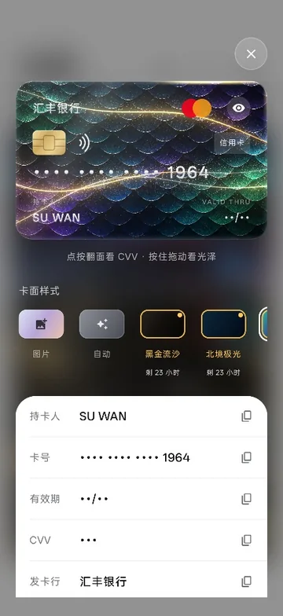</td>
    <td align="center" width="33%">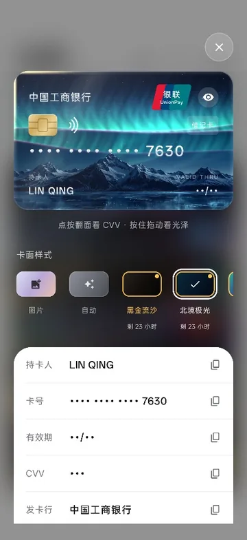</td>
    <td align="center" width="33%">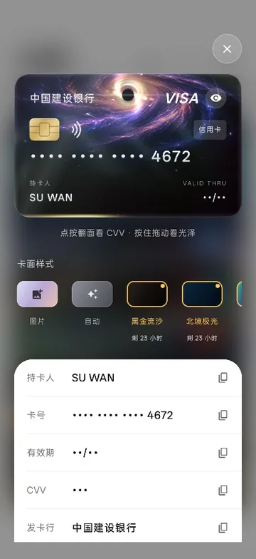</td>
  </tr>
  <tr>
    <td align="center"><b>龙鳞</b><br><sub>倾斜时薄膜虹彩沿鳞缘流转，两道金光在鳞片上游动</sub></td>
    <td align="center"><b>北境极光</b><br><sub>极光在雪峰上空舞动，冰面倒映、裂纹里流光，偶有流星划过</sub></td>
    <td align="center"><b>星璇</b><br><sub>星系中心是一个黑洞：光环与吸积盘飞转，彗星绕核公转</sub></td>
  </tr>
  <tr>
    <td align="center">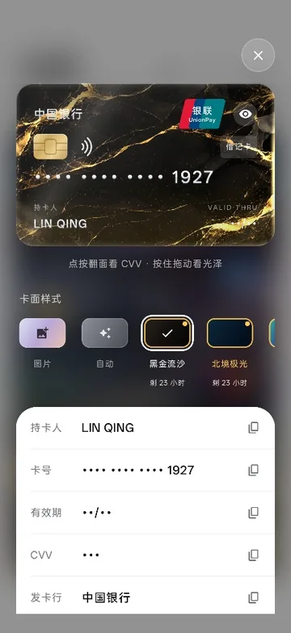</td>
    <td align="center">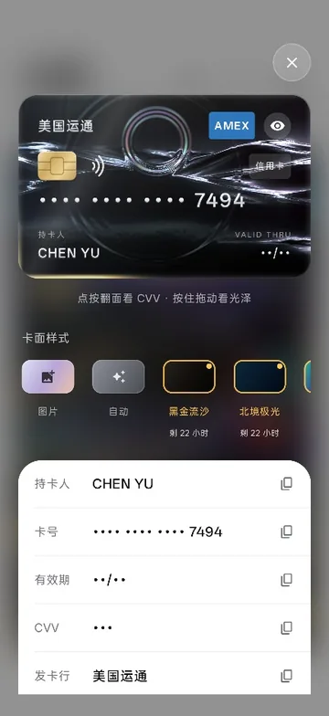</td>
    <td></td>
  </tr>
  <tr>
    <td align="center"><b>黑金流沙</b><br><sub>金脉沿倾斜方向逐段亮起，金沙在较低的一侧汇聚</sub></td>
    <td align="center"><b>液态铬</b><br><sub>水银滴荡开涟漪，灯带随倾斜在波峰间滑动，映出冷暖光泽</sub></td>
    <td></td>
  </tr>
</table>

不想要动效的话，在「设置 → 外观 → 卡面动效」里关掉，卡面就会静止，更省电。

也可以不用皮肤，直接给卡片导入一张照片或 GIF 当卡面，光泽和边缘效果照样保留。

## 深色模式

<table>
  <tr>
    <td align="center" width="33%">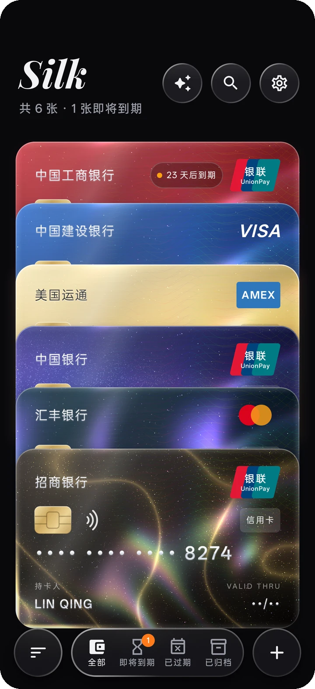</td>
    <td align="center" width="33%">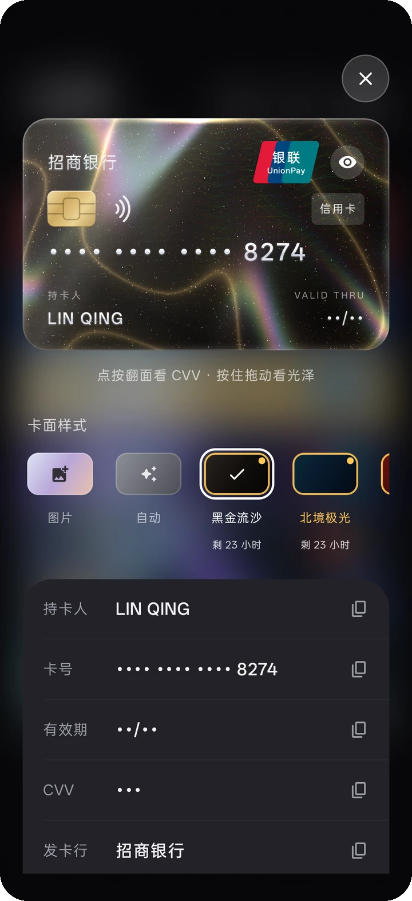</td>
    <td align="center" width="33%">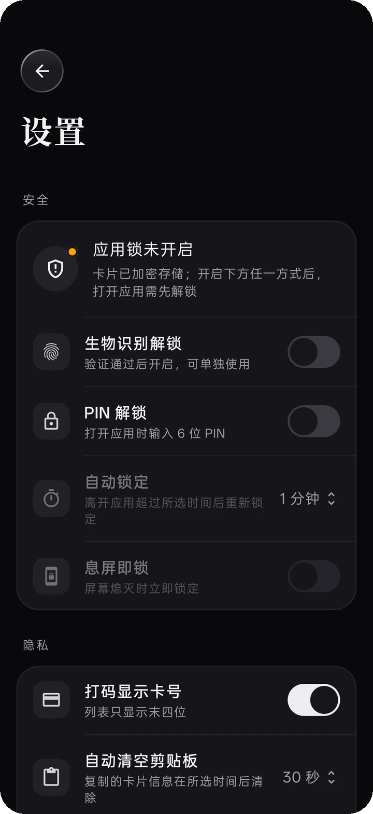</td>
  </tr>
</table>

可以跟随系统，也可以在设置里固定为浅色或深色。

## 隐私与安全

- **只存在本机**：数据库由 SQLCipher 加密，密钥受 Android Keystore 保护；不需要账号，也没有服务器
- **上锁**：6 位 PIN 与生物识别；离开应用超过设定时间自动锁定，也可以设为息屏即锁
- **防偷看**：卡号默认打码；可开启防截屏（同时隐藏最近任务里的预览）；复制后按设定秒数自动清空剪贴板
- **加密备份**：备份文件用你设的密码加密（PBKDF2 + AES-GCM），换手机时导入即可。导入的卡面照片和动图保存在本机
- **不联网**：除了你主动发起的 BIN 查询（只发送卡号前 8 位）和检查更新，应用不发起任何网络请求；也可以在设置里开启完全离线

## 构建

需要 JDK 17+ 和 Android SDK（compileSdk 34）。

```bash
./gradlew assembleDebug
```

调试包的包名是 `app.silk.wallet.debug`，可以和正式版同时安装。

正式版签名从环境变量读取：`SILK_KEYSTORE`、`SILK_KEYSTORE_PASSWORD`、`SILK_KEY_ALIAS`、`SILK_KEY_PASSWORD`。这些变量未设置时，正式版会改用调试签名。

```bash
./gradlew assembleRelease
```

### 截图工具（仅调试包）

调试包带一个截图钩子，只截应用自己的窗口，不含状态栏和其他悬浮窗。README 里的图都是用它拍的：

```bash
# 换成一组演示卡（会清空调试包里现有的卡）
adb shell am broadcast -a app.silk.wallet.debug.SHOT -p app.silk.wallet.debug --ez seed true
# 截一张图
adb shell am broadcast -a app.silk.wallet.debug.SHOT -p app.silk.wallet.debug --es name home
# 连拍 3 秒，用来做动图
adb shell am broadcast -a app.silk.wallet.debug.SHOT -p app.silk.wallet.debug --es name open --ei burst 3000
```

图片保存在 `/sdcard/Android/data/app.silk.wallet.debug/files/shots/`。正式包里没有这段代码。

## 技术栈

Kotlin · Jetpack Compose · Material 3 · AGSL 着色器 · Room + SQLCipher · DataStore · WorkManager · OkHttp · [Haze](https://github.com/chrisbanes/haze)（毛玻璃）

最低支持 Android 8.0。流动卡面需要 Android 13 及以上，更低的版本显示静态底图或渐变。

## 字体

- Playfair Display（字标），SIL Open Font License 1.1
- 思源宋体 Noto Serif SC（标题，子集化），SIL Open Font License 1.1

新增中文文案后，运行 `python tools/subset_fonts.py .` 重新生成宋体子集。

## 许可

[MIT](LICENSE)
